# Art direction: Painterly World, Painted Actors

**Status: DRAFT for team review.** This is the living art bible for World of ClaudeCraft.
Every new or reworked model, texture, shader look, zone palette and encounter room is judged
against it. When this doc and the shipped game disagree, the game is the thing to change,
unless the team amends this doc first.

The decision behind it: after comparing six styles and three finalists, the team chose
**Painterly World + Painted Actors**. The world is soft, atmospheric and painterly, in the
spirit of Breath of the Wild; every character, creature and boss gets a hand-painted
treatment, in the spirit of World of Warcraft, so actors always read clearly against it.

Reference images for this doc live in [`art-direction/`](art-direction/). Files named
`target-*` show the look we are aiming for; files named `avoid-*` show what this doc rules
out. Every `target-*` and `avoid-*` image except the in-game Varkhul capture is an AI
repaint of a real in-game capture (gpt-image-2 edits). They show intent, not a real-time
render, so match their rules, not their pixels.

| Target: actor in the world | Target: a Crucible boss |
|---|---|
| 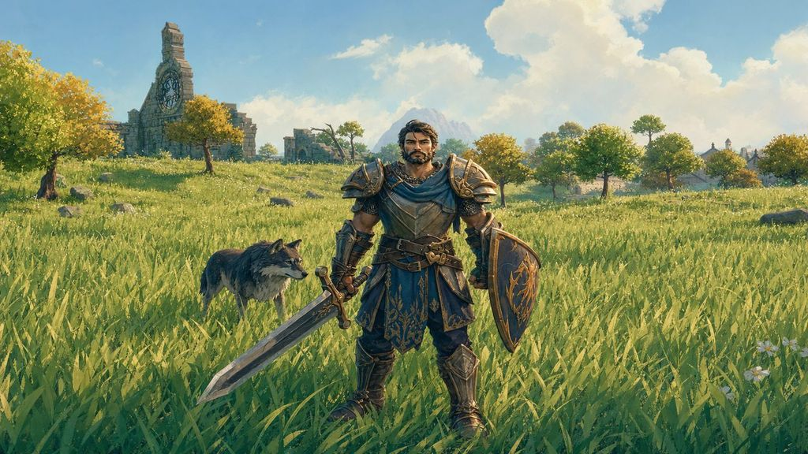 | 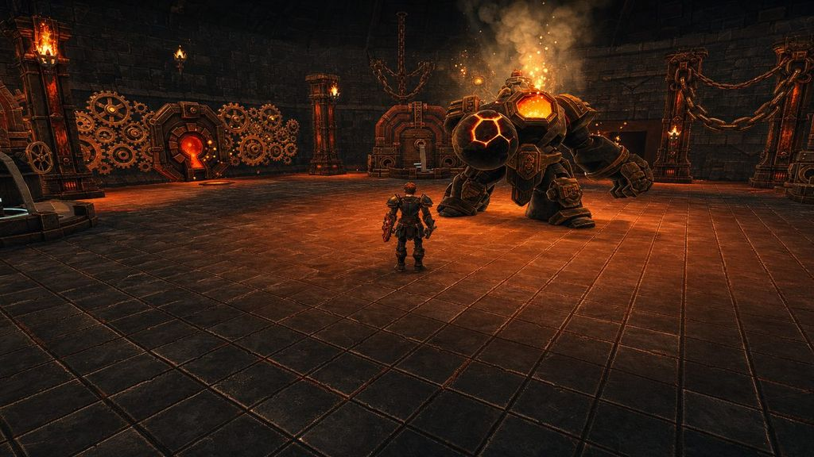 |

## 1. Pillars

1. **Painterly world, painted actors.** Two treatments under one light. The world is
   gouache-soft; actors are hand-painted and crisp.
2. **Actors always read first.** In any frame, the strongest value contrast, the crispest
   edges and the most saturated colour belong to an actor. In an encounter room the boss
   outranks everything, players included.
3. **Colour is zone identity.** Each zone owns a signature hue that the painterly treatment
   must keep. Naturalism never flattens Nightbloom into a green meadow.
4. **One light.** World and actors share the sun direction, sky colour, contact shadows and
   haze tint. Two treatments, never two lighting rigs.
5. **The phone sees the same game.** The look lives in textures and in-material shading,
   never in post-processing. Low and iOS keep the full look with less density, not a
   different style. This is the graphics-fairness rule applied to art: see
   [`graphics-settings-fairness.md`](graphics-settings-fairness.md).

## 2. The world

Covers terrain, grass, foliage, rocks, buildings, dungeon and raid rooms, water and sky.

| Rule | Spec |
|---|---|
| Shading | Soft ramp: lit and shadow tones with a blended terminator, never a hard two-band cut. Shadow side is a coloured fill (the zone's shade tint), never grey or black. |
| Values | Compressed toward the middle. On a 0 to 10 value scale, near world sits within 2 to 8; distant world eases toward the haze value. No pure black, no pure white. |
| Colour | Earthy, painted, warm light against cool shade. Grass is yellow-green in the light and teal-green in the shade. Each zone's signature hue is kept at full strength in its hero surfaces (Nightbloom's violet flowers, Amberfall's gold canopy). |
| Textures | Painted, brushy, low frequency. Detail comes from shape and colour shifts, not noise. Photo-sourced tiling textures are retired as assets are reworked. |
| Atmosphere | Strong aerial perspective: distance fades and desaturates toward the zone's haze colour, which matches the horizon sky so distance reads as air. |
| Outlines | None. No ink lines on terrain, foliage or architecture. |
| Grass | Soft blades with gradient tips, below an actor's knee at gameplay camera distance, opaque where the tier allows. Density scales by tier; the colour and shape do not. |
| Foliage | Round, readable canopy masses (the puffball sculpt is the right direction), painted gradient from sunlit top to shaded underside. |
| Architecture | Chunky, slightly exaggerated proportions, painted wear on edges, big readable roof shapes. Each town keeps its material set (slate, thatch, timber, stone) as its identity. |
| Sky | Painted gradient with soft brushy clouds. See open question 2 for HDRI versus painted. |

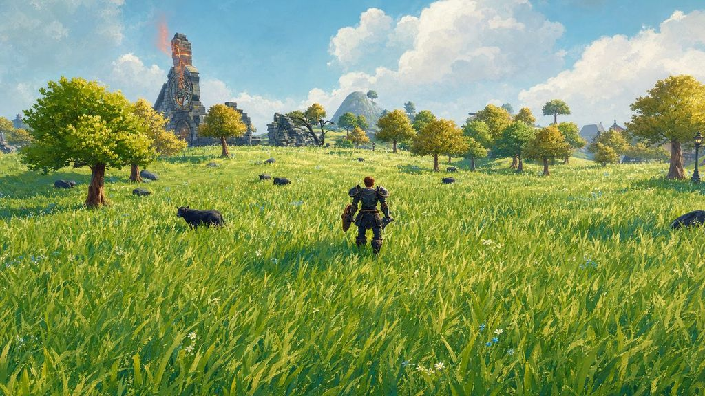

| Target: Eastbrook town | Target: Frostveil Reach |
|---|---|
| 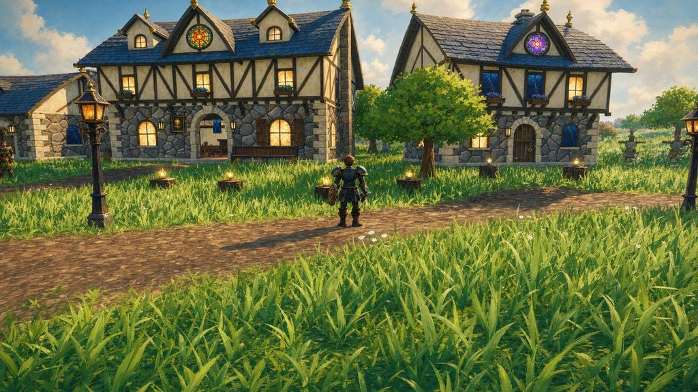 | 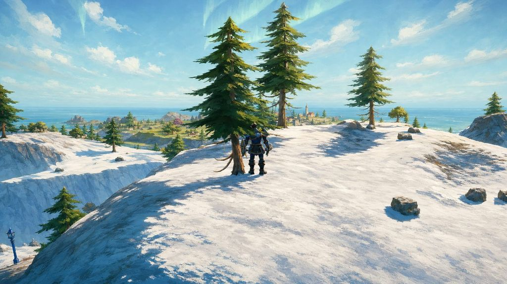 |

## 3. Actors

Covers player characters, NPCs, creatures, mobs, bosses, mounts and held gear.

| Rule | Spec |
|---|---|
| Proportions | Heroic and chunky: about 6.5 to 7 heads tall, broad shoulders, hands, pauldrons and weapons about 1.2 times realistic size. Starting values: tune them in the slice (section 8). |
| Silhouette | Readable at 40 yards from the gameplay camera: class role, weapon and armour tier recognisable from the shape alone. Gear progression grows the silhouette (bigger pauldrons, longer cloaks, crests). |
| Shading | Same sun as the world, crisper terminator than the world, plus a warm rim light on the side away from the camera's key. |
| Values | Full range, 1 to 9: deep darks in creases and under plates, painted highlights on edges. An actor is always the highest-contrast shape in its neighbourhood. |
| Colour | Slightly more saturated than the world around it. Faction and class colours are bold and blocky, not noisy. |
| Textures | Hand-painted albedo carrying the light: painted top-down key, cool painted shade, painted ambient occlusion in creases, crisp painted highlights on metal edges and trim. |
| Faces and hair | Painted planes, clear eye and brow shapes, hair in sculpted clumps. Faces read at MMO camera distance before they read up close. |
| Haze | Actors take about a quarter of the world's haze, so a mob at 40 yards still reads. See open question 1. |
| Outlines | None. Readability comes from value and edge highlights, not ink. |
| Glow | Emissives (eyes, runes, furnace cores, spell foci) are the brightest values on the actor and stay within shapes. |

| Target: warrior | Target: mage |
|---|---|
|  | 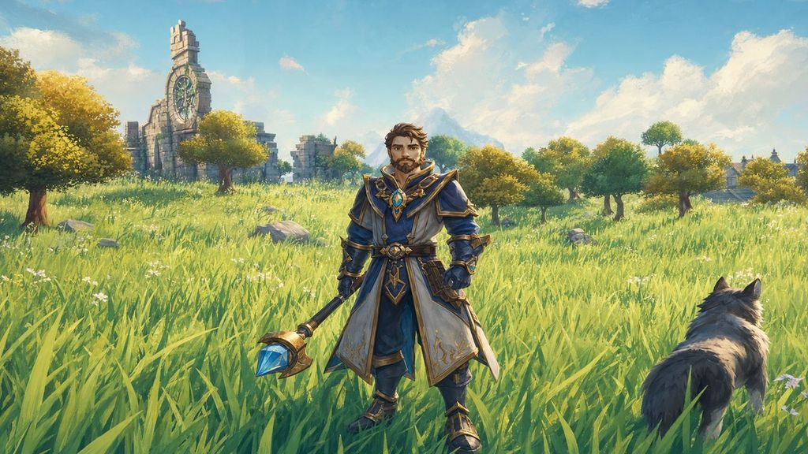 |

## 4. Bosses and encounter rooms

- **The boss is the brightest shape in the room.** Room surfaces sit in the lower-middle
  values; the boss carries the room's highest emissive and its widest value range.
- **Rooms frame, they do not compete.** Room colour supports the boss palette but at lower
  saturation. Lava, braziers and machinery may glow, but never brighter than the boss's core.
- **Telegraphs outrank everything.** Mechanic telegraphs stay legible over both the room and
  the boss; VFX readability rules in `src/render/CLAUDE.md` still apply.
- **The Crucible palette.** Charcoal basalt, gunmetal and dark iron, burnt bronze accents,
  a white-hot core with yellow-orange inner fire. Magma lives only inside cracks and furnace
  openings (from [`ignivar-boss-model/provenance.md`](ignivar-boss-model/provenance.md)).
  The room stays in muted basalt and bronze so the boss's furnace reads first.

| Target: Ignivar | Target: Varkhul |
|---|---|
|  | 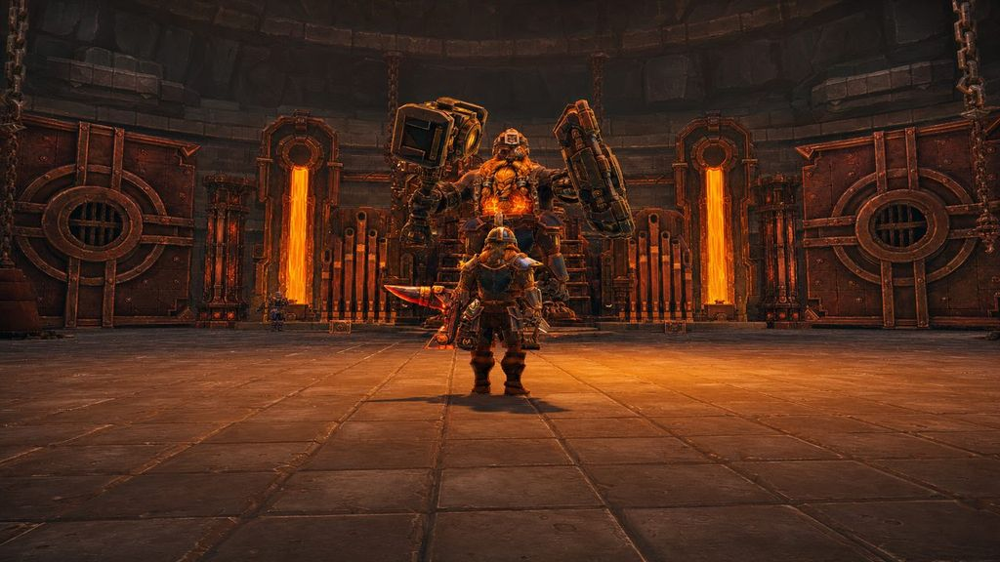 |

## 5. Zone palette sheets

Each zone gets one sheet: signature hue, light tint, shade tint, haze and horizon colour,
grass light and shade, and the actor accent that pops against it. The starting points
are the curated looks in the palette lab (`src/render/palette_lab/zone_looks.ts`), whose
shared rules already match this doc: warm key light, coloured cool shade, horizon-matched
haze, and lifted rather than crushed blacks.

| Zone | Signature hue to keep | Starting look in the palette lab |
|---|---|---|
| The Proving Shore | Pink-gold sunrise light | Dawnrest Sunrise |
| Eastbrook Vale | Lime light, emerald shade, cyan sky | Windrise Meadow |
| The Farshore | Jade grass, glowing lagoon | Tropic Lagoon |
| Mirefen Marsh | Emerald marsh, cyan sky | Emerald Bayou |
| Thornpeak Heights | Deep blue sky, cool stone | Alpine Clear |
| The Veiled Hollow | Pink-mauve dusk, violet shade | Rosewater Twilight |
| The Drakelands | Red-orange magma glow, purple-black shade | Molten Dusk |
| The Frostveil Reach | White snow, cyan shadows | Crystal Noon |
| The Amberfall | Gold canopy and grass | Sky Island Gold |
| The Willowfen | Pastel spring greens, pale water | Spring Watercolour |
| The Nightbloom | Lavender and violet meadows | Dreamlight Lavender |
| The Wraithwood | Grey-teal fog | Grave Mist |
| The Palmreach | Saturated palms, red flower accents | Tropic Paradise |
| The Evergarden | Vivid manicured green | Sunlit Topiary |
| The Galecrest | Lavender-pink dawn, pearl sea | Seawind Dawn |

The palette lab is a temporary dev tool today (`?palette=on`); shipping these sheets means
promoting the chosen looks to the stock tables. That is a phase 2 task, not part of this doc.

| Target: Nightbloom keeps its violet | Avoid: naturalism erases the zone |
|---|---|
| 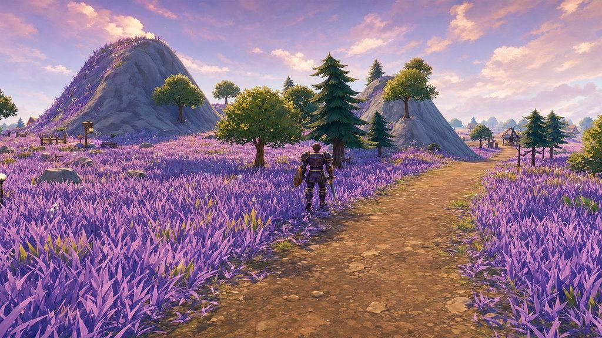 | 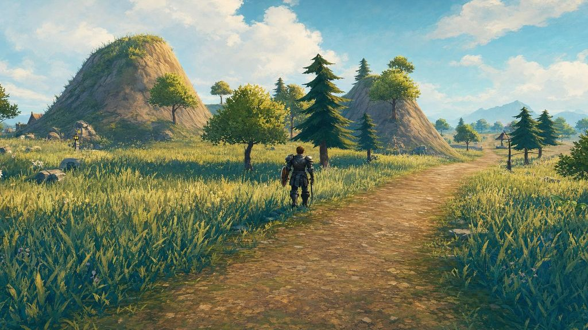 |

## 6. Technical spec

The look must hold on every graphics tier, including Low and iOS (Lambert materials, no
post-processing, no shadows). Nothing in this section may depend on a post pass.

| Item | Spec |
|---|---|
| Actor textures | One hand-painted albedo per material, KTX2 (ETC1S suits painted colour). No normal or metal/roughness maps; wear and form are painted. An optional emissive mask for glows. |
| Actor texture size | Player armour and bosses 1024; mobs and NPCs 512; held props 256 to 512. The local player's existing high-tier top mip stays. |
| World textures | Painted tiling sets per material family, KTX2. Terrain keeps its splat blend with painted layers in place of photo-sourced ones. |
| Geometry | Existing budgets hold: today's WOC player bodies and the Crucible creature budget are the reference points. Chunky shapes spend triangles on silhouette, not surface noise. |
| World shading | One world material family: soft ramp on the sun, coloured hemisphere fill, full haze. |
| Actor shading | One actor material family: crisper ramp on the sun, warm rim, reduced haze, slight saturation lift. A pure, Vitest-pinned core behind the render seam, in the same pattern as `cel_shading_core.ts`. |
| Shader programs | Two families means more programs to prepare. Both go through the GPU preparation scheduler (see "GPU work" in `src/render/CLAUDE.md`). |
| Fairness | Actor readability is never a tier knob. A test asserts the actor treatment is identical across tiers. |

## 7. Making assets

- **AI-assisted is fine; unreviewed AI is not.** Tripo and image-model outputs pass through
  four steps: delight (remove baked light that fights the painted key), palette remap to the
  zone or faction sheet, a paint-over for edge highlights and faces, then a turntable review.
- **Retarget the pipeline's style references.** The asset pipeline's style board
  (`scripts/asset_pipeline/lib/style_ref.mjs`, `prompts.mjs`) currently asks for chibi
  KayKit-style proportions. It must point at approved slice assets instead, before any new
  actor is generated.
- **One reference rig.** Every new GLB is reviewed on a turntable under the same sun, sky and
  haze, beside an approved actor of the same family.
- **Repaint by visibility.** Player bodies and armour first, then bosses, then common mobs,
  towns, terrain and foliage.

## 8. Do and do not

| Do | Do not |
|---|---|
| Give every actor a full value range and painted edge highlights | Let an actor take the world's compressed values 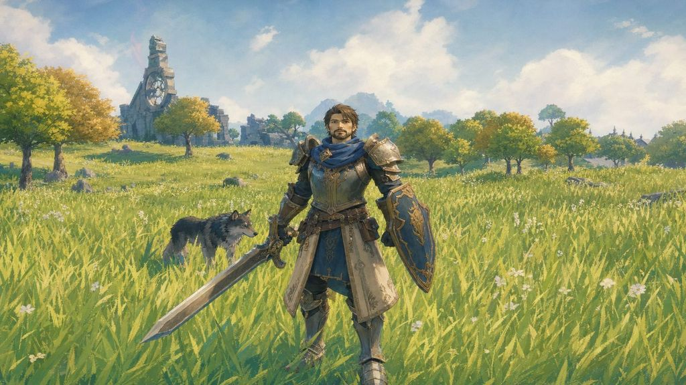 |
| Make the boss the brightest shape in its room | Let boss iron match the room's iron 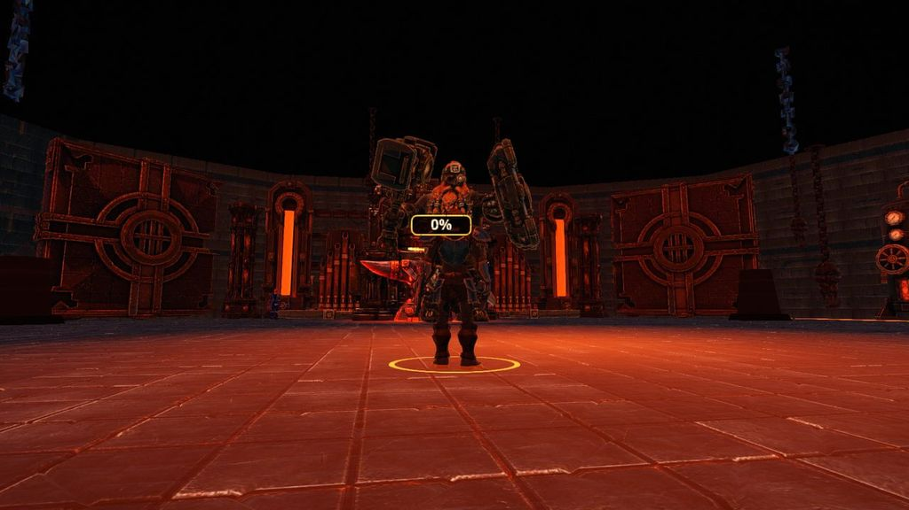 |
| Keep each zone's signature hue | Mute every zone toward natural green and brown |
| Keep the world soft and calm so actors pop | Give the world the actors' saturation and contrast 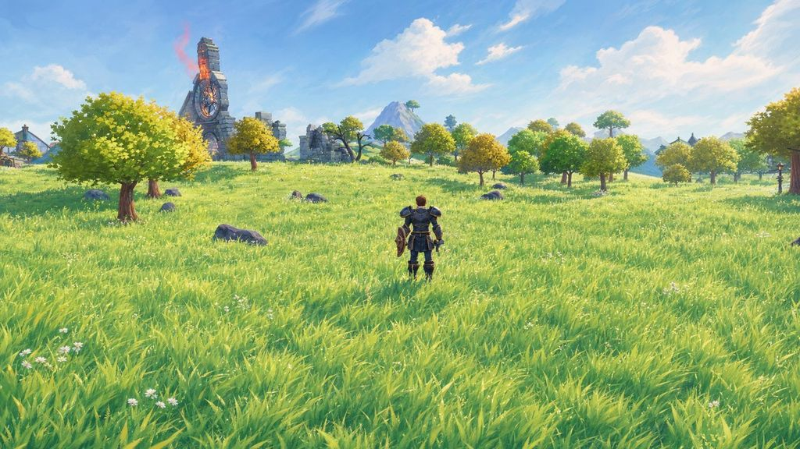 |
| Paint light and wear into textures | Rely on normal maps, specular or post-processing for the look |
| Share one sun, sky and contact shadows | Light actors with a separate rig that makes them look pasted on |
| Grow silhouettes with gear tier | Add surface noise to signal rarity |

## 9. Review checklist (every visual PR)

1. Does every actor read first in the frame, and the boss first in its room?
2. Is the zone's signature hue intact?
3. Are world and actor treatments both present and lit by the same sun?
4. Is there a phone Low capture beside the desktop one, and do they show the same look?
5. Is the new asset's texture set one painted albedo (plus an optional emissive mask)?
6. Was the asset reviewed on the reference turntable beside an approved actor?

## 10. Open questions

1. **Actor haze:** about a quarter of the world amount, or none for maximum readability?
2. **Sky:** keep the per-biome HDRI dome under a painterly grade, or move to a painted
   gradient with cloud cards?
3. **Who paints actors:** a dedicated painter, AI paint-over with a painter's final pass, or
   both?
4. **Slice target:** which release the in-engine slice (Eastbrook Vale, the Ignivar arena,
   the warrior and mage, the forest wolf) aims for, and who owns each phase.
